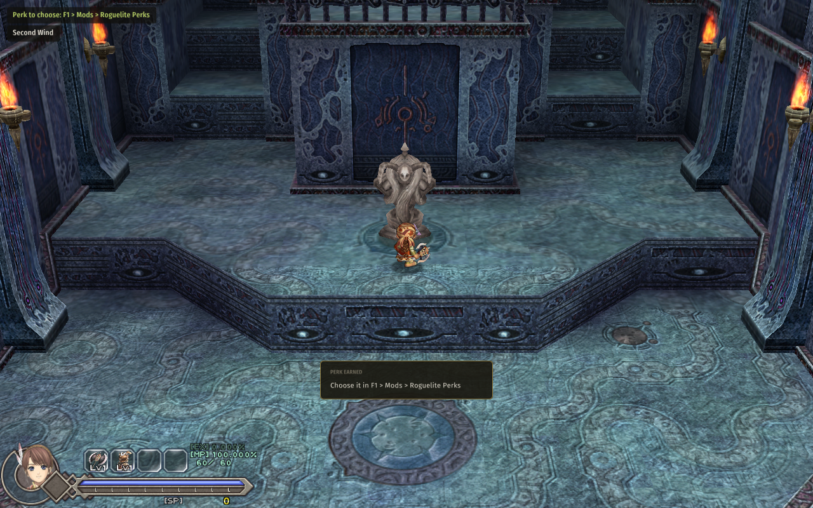

# Roguelite Perks

For **Ys Origin** on CleriaCore. Every boss, mid-boss or duel you win lets you choose **one of three random
perks**. They stack, they are kept with the save, and no two runs build the same way.



| Perk | One stack | Most |
|---|---|---|
| **Might** | +8% ATK | 5 |
| **Guard** | +8% DEF | 5 |
| **Vigor** | +15 max HP | 6 |
| **Leech** | Each kill heals 2 HP | 3 |
| **Scavenger** | +10% chance that a kill drops a Recovery Drop | 3 |
| **Greed** | +20% SP from kills and gold | 3 |
| **Scholar** | +15% EXP | 3 |
| **Lingering** | Strength, Defense and MP Drop buffs last 50% longer | 2 |
| **Second Wind** | Once per room, a hit that would kill you leaves you at 1 HP | 1 |

When a perk is earned a card says so, and a line in the corner reminds you. Choose it in
**F1 > Mods > Roguelite Perks**: three buttons, each with what it does. The three on offer are stored with the save,
so reloading does not reroll them.

Options on the same page: start a new game with one perk to choose (on), let the mod pick at random for you (off),
show the corner lines (on).

## Install

1. Download `4rtefakt.perks-1.0.0.cleriamod` from the [releases](../../releases).
2. Double-click it (or use F1 > Mods > *Install a mod file...*).
3. Turn **Roguelite Perks** on in F1 > Mods and restart CleriaCore.

Needs a CleriaCore with mod API 6.

## How it works

One Lua file, [main.lua](main.lua), about 200 lines. A perk is a row in a table plus one rule:

```lua
-- Second Wind: once per room, a hit that would kill leaves 1 HP
cleria.combat.add_filter("damage", function(q)
    if q.dir ~= "taken" or n("secondwind") == 0 or wind_used then return nil end
    local hp = P.hp()
    if hp > 1 and q.value >= hp then
        wind_used = true
        return hp - 1
    end
end)
```

| Perk | API |
|---|---|
| Might, Guard, Vigor | `cleria.player.set_modifier` (kept through level-ups and equipment by the engine) |
| Leech | the `enemy_killed` event and `player.set_hp` |
| Scavenger | `cleria.game.spawn_pickup` at the monster's position |
| Greed, Scholar | the `"sp"` and `"exp"` combat filters |
| Lingering | the `"pickup"` filter, replacing a buff's `ticks` |
| Second Wind | the `"damage"` filter on hits taken |
| Earning and choosing | the `boss_defeated` event, `cleria.save` (a table), `cleria.ui.page` buttons |

## Tests

`python .dev/run.py` runs five cases through CleriaCore's headless harness, on the engine's own numbers: a new game
offers three perks, one is taken, a boss flag earns the next and a save and load brings it all back; Might, Guard
and Vigor give ATK 49.68, DEF 41.04 and max HP 75 then 90; a kill with Leech, Scholar and Greed heals 2 HP and pays
58.6 EXP and 5 SP instead of 50.96 and 4; Second Wind turns a 400-damage hit into 1 HP left once, and the next one
kills.

Not covered by a test: Scavenger (it is a random roll) and Lingering. The balance is a first guess: nobody has
played a full run with it.

## More CleriaCore mods

Each one is a small Lua mod that shows a different part of the mod API:

- [Mutators](https://github.com/4rtefakt/cleriacore-mutators): challenge rules: Glass Cannon, Berserker, One Hit, Vampire, Midas, Famine, Permadeath, a level cap
- [Solo Randomizer](https://github.com/4rtefakt/cleriacore-solo-randomizer): the tower's chests shuffled from a seed, always beatable, no server
- [Run HUD](https://github.com/4rtefakt/cleriacore-run-hud): room and run time, kills, deaths, damage per second
- [Crowd Control](https://github.com/4rtefakt/cleriacore-crowd-control): Twitch chat votes on what happens to you
- [Adaptive Difficulty](https://github.com/4rtefakt/cleriacore-adaptive-difficulty): enemies hit softer after each death, and return to normal as you progress
- [LiveSplit Autosplitter](https://github.com/4rtefakt/cleriacore-livesplit): starts and splits LiveSplit over its WebSocket server
- [Bestiary+](https://github.com/4rtefakt/cleriacore-bestiary): a per-save hunting log of every monster killed
- [Archipelago](https://github.com/4rtefakt/ys-origin-cleriacore-ap): the multiworld randomizer client, the biggest one

## About

Written with AI assistance (Claude Code) as a showcase of the CleriaCore mod API, and tested as described above.
MIT license.
